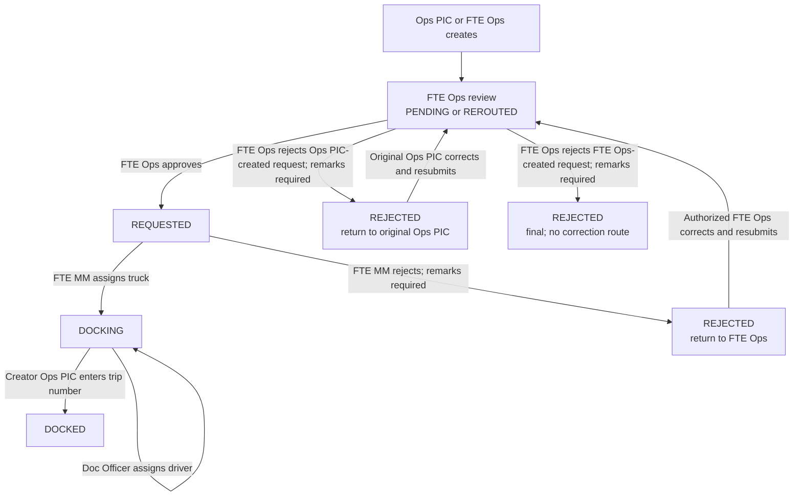

# Request workflow and state transitions

## Status vocabulary

The current workflow stores `PENDING`, `REROUTED`, `REQUESTED`, `REJECTED`,
`CANCELLED`, `DOCKING` and `DOCKED`. `ASSIGNED` remains in the application
enum/display contract but is not the normal transition target in the audited
service. The initial SQL enum also included legacy values such as `APPROVED`,
`REJECTED_BY_MM`, `FOR_DOCKING` and `CONFIRMED`; the migration
`supabase/migrations/20261009000000_normalize_legacy_request_statuses.sql`
maps some legacy values to the current vocabulary. Preserve compatibility
until historical data and clients have been reconciled.

Sources: `backend/app/Features/Requests/RequestStatus.php`,
`backend/app/Features/Requests/RequestService.php`,
`supabase/migrations/001_initial_schema.sql`,
`supabase/migrations/20261009000000_normalize_legacy_request_statuses.sql`.

## V2 transition matrix

The matrix records the v2 workflow policy, including the APR-3 approved
rejection route. Existing-source behavior may differ as noted in the source
audit; APR-3 is a target behavior, not a claim that the current backend
implements it.

| Current state | Action / actor | Next state | Effects and constraints |
|---|---|---|---|
| New | Create by Ops PIC or FTE Ops | `PENDING` | `REQUEST_CREATED`, FTE Ops notification; optional SeaTalk routing/provisioning after commit. |
| `PENDING` / `REROUTED` | Approve by FTE Ops (Web or valid SeaTalk assignment) | `REQUESTED` | Approval metadata and event; FTE MM notified; active assignments closed; provider sync queued. |
| `PENDING` / `REROUTED`, created by Ops PIC | Reject by FTE Ops | `REJECTED` | Remarks required; set `rejection_return_role=ops_pic`; notify original Ops PIC creator for correction. |
| `REJECTED` from FTE Ops rejection of an Ops PIC-created request; return role `ops_pic` | Edit/resubmit by original Ops PIC creator | `PENDING` | Only the original creator may correct. Clear active return routing, reset approval state, increment version/correlation, append event and notify the FTE Ops review destination. |
| `PENDING` / `REROUTED`, created by FTE Ops | Reject by FTE Ops | `REJECTED` | Remarks required; final rejection with no correction route, no return role, and no resubmission. Notify original FTE Ops creator and retain as non-actionable history. |
| `REQUESTED` | Assign truck by FTE MM | `DOCKING` | Plate, size/type, provide time; `TRUCK_ASSIGNED`; Doc Officer notified. |
| `REQUESTED` | Reject by FTE MM | `REJECTED` | Remarks required; `rejection_return_role=fte_ops`; FTE Ops notified for correction and renewed approval. |
| `REJECTED` from FTE MM rejection; return role `fte_ops` | Edit by authorized FTE Ops return actor | `PENDING` | Same reset/resubmission semantics; approval must occur again. This is distinct from final FTE Ops rejection of an FTE Ops-created request. |
| `DOCKING`, driver blank | Assign driver by Doc Officer | `DOCKING` | Driver ID 1–10 digits and assignment timestamp; emits `DRIVER_ASSIGNED`. |
| `DOCKING`, driver present | Reassign driver by Doc Officer | `DOCKING` | Explicit action only; records new and prior driver IDs in event metadata. |
| `DOCKING`, driver present | Enter linehaul trip number by creator Ops PIC | `DOCKED` | Trip and docking timestamps; `TRUCK_DOCKED`; closes assignments and synchronizes provider state. |
| Eligible stage | Cancel by creator Ops PIC or responsible FTE | `CANCELLED` | FTE MM must supply remarks; records source/version/correlation, event, notifications; closes assignments and syncs provider. |
| `DOCKED` | Edit by creator Ops PIC | `DOCKED` | Post-dock data edit, audit event and operational notifications; status is retained. |

For correctable rejected requests, preserve the prior rejection, remarks,
actor, return target, and event history. Resubmission creates a new approval
cycle and does not approve the request. The subsequent FTE Ops approval must
pass normal authorization and SeaTalk Approval Center requirements. The
FTE Ops-created request rejected by FTE Ops is final and is not a
correctable/resubmittable rejected state.

## Workflow diagram

## APR-3 rejection-routing and correction requirements

- **Routing:** FTE Ops rejection returns an Ops PIC-created request to that
  original Ops PIC creator. FTE Ops rejection of an FTE Ops-created request
  is final and has no correction route or return role. FTE MM rejection
  continues to route to FTE Ops. Never accept a return destination from the
  client.
- **Authorization:** Rejection requires current FTE Ops approval authority,
  valid workflow state, and required remarks. For a correctable Ops
  PIC-created request, only the authenticated original creator in the
  expected return role can correct while status is `REJECTED`; other users
  with the same role are denied. An FTE Ops-created request rejected by
  FTE Ops is not editable or resubmittable by any actor. FTE MM rejection
  continues to return to the FTE Ops role under its existing authorization
  policy.
- **State transition:** Rejection sets request status to `REJECTED` and
  approval status to `REJECTED`. For an FTE Ops-created request rejected by
  FTE Ops, leave no actionable return route; do not permit correction or
  resubmission. For a correctable Ops PIC-created request, correction/
  resubmission returns status to `PENDING`, resets approval status to
  `PENDING`, clears active rejection routing, and starts a new
  version/correlation. Neither path alters or removes the prior rejection
  record.
- **Notifications:** Notify the original creator of rejection, including
  the FTE Ops creator when the rejection is final, and notify any other
  explicitly assigned affected recipients under the approved event-time
  targeting rule. On resubmission of a correctable request, notify the
  explicitly routed FTE Ops review recipient(s) at event time.
  Persist/deduplicate notification intent with the workflow change; realtime
  is only a best-effort signal. SeaTalk remains mandatory for approval
  operations.
- **Immutable audit:** Append distinct rejection and resubmission records
  with actor and original creator identity, timestamp, from/to status and
  approval status, rejection remarks, return target where applicable,
  changed-field before/after values, version, and correlation ID. Historical
  events must not be edited or deleted.

The FTE MM display renders stored `DOCKING` as `ASSIGNED`; FTE MM and Doc
Officer display `REROUTED` as `PENDING`. These are view mappings, not
transitions.

## Ownership and guard conditions

- Request row is locked before state mutation, then role/status/ownership
  authorization is checked. Invalid state/action is a conflict; forbidden
  actor is denied. Web approval/rejection authorization precedes idempotent
  replay handling.
- SeaTalk decisions require an assignment belonging to that user and request,
  an active unexpired assignment for new decisions, a matching employee code,
  and current active profile/role.
- For repeated SeaTalk callback IDs, payload fingerprints are checked.
  Processed/ignored callback receipts are acknowledged according to stored
  state; mismatched reused IDs conflict.
- Bulk approval is FTE Ops-only, takes 1–100 distinct UUIDs, and runs through
  the same transition service.
- The public `POST /requests/{id}/mark-docked` is role-dependent: Doc Officer
  supplies `driver_id` and remains in `DOCKING`; creator Ops PIC supplies
  `linehaul_trip_no` and moves to `DOCKED`.
- Do not implement transitions as client-side status updates. The frontend
  state presentation is not authoritative.

## Ordering clarification

The normal business handoff is **Ops PIC or FTE Ops creates → FTE Ops
approves/rejects →
FTE MM assigns truck/rejects → Doc Officer assigns driver → creator Ops PIC
records trip number and completes docked state**. Thus Doc Officer is not the
final terminal actor in this implementation: the workflow returns to the
creator Ops PIC for linehaul trip entry and `DOCKED`.

The approved v2 workflow uses the creator Ops PIC for final linehaul trip
entry. Non-creator Ops PIC completion remains disallowed. Legacy `ASSIGNED`
is historical-only for active workflow purposes; see
[`09-business-decisions.md`](./09-business-decisions.md) for the full
approved status rules.

## Concurrency and transactional requirements to preserve

The audited service locks request rows, changes request state and adds
`request_events` inside database transactions. Notifications and external
provider/sheet effects are routed through after-commit outbox records where
the outbox is installed. Approval `approval_version` and
`approval_correlation_id` support versioning/correlation. Preserve these
atomicity and duplicate-decision properties in v2.

**Verified reliability gap:** Failed outbox work is changed back to `PENDING`
with a future `available_at` or dead-lettered, but the audited scheduler has
no recurring pending-outbox dispatcher. The queued `ProcessWorkflowOutbox`
job has `tries = 1`; rescheduling only changes the database row. A later
mutation may redispatch an existing outbox item in some paths, but that is
not a reliable retry mechanism. Notification intents can therefore remain
pending without delivery. SeaTalk reconciliation and scheduled full Sheets
sync provide separate recovery paths for some provider/report side effects,
but do not drain or complete the corresponding outbox rows. Add a
scanner/worker or a durable queue retry design before relying on automatic
outbox retries.

Sources: `backend/app/Features/Requests/RequestService.php`,
`backend/app/Features/Approvals/ApprovalService.php`,
`backend/app/Features/Approvals/SeaTalkApprovalCallbackController.php`,
`backend/app/Jobs/ProcessWorkflowOutbox.php`,
`backend/app/Features/Outbox/WorkflowOutboxRepository.php`,
`backend/bootstrap/app.php`,
`backend/tests/Feature/WorkflowOutboxProcessingTest.php`.
